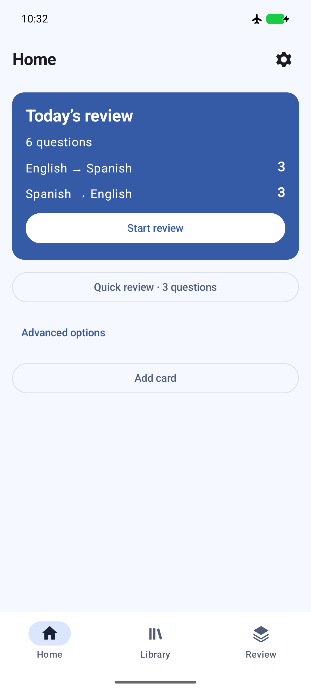
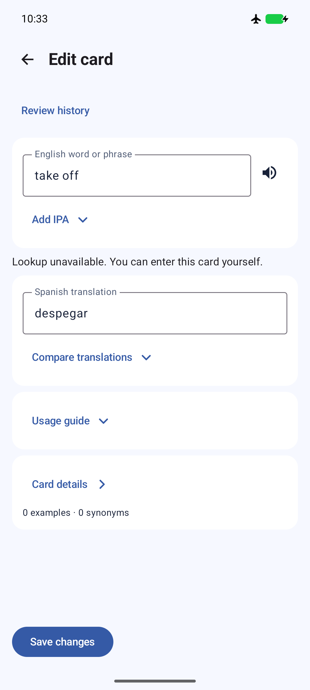
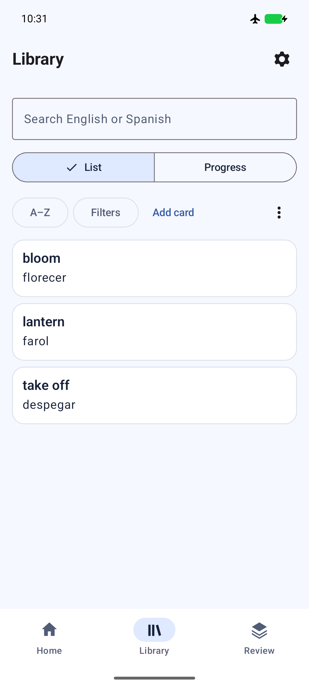
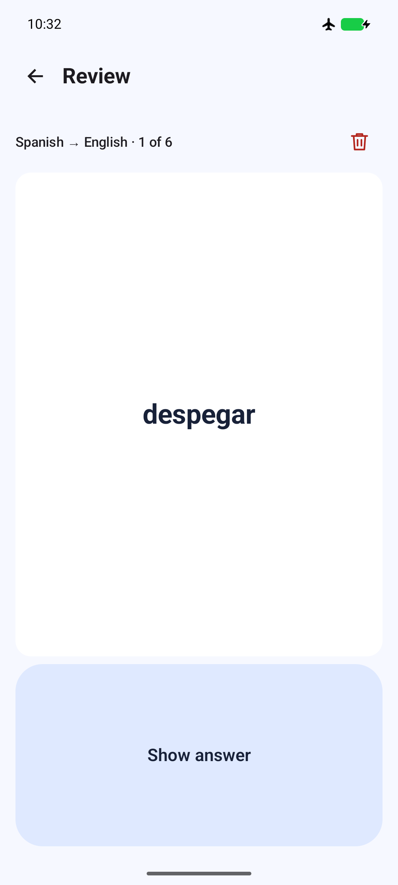
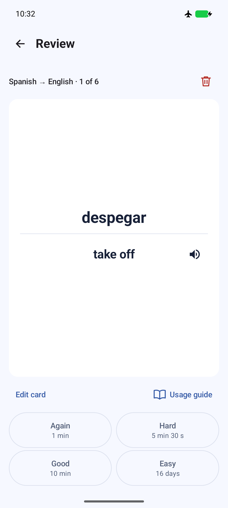
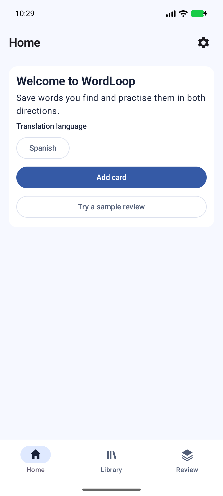

# WordLoop

A vocabulary notebook for English words you want to remember. Save Spanish or Japanese translations, keep examples and pronunciation with each word, and practise with flashcards on Android.

## What you can do

- Add words by hand, look up meanings in Wiktionary, or start a card from Android’s **Share** menu.
- Keep separate cards for different meanings. Add examples, synonyms, tags and English IPA. Listen with an installed English voice.
- Search your library and filter by language, tag, review direction or progress.
- Start a scheduled review, take a quick session of up to ten questions, or practise without changing the schedule.
- Share selected cards as packs. Export a `.dvc` backup to move your cards, settings and review history.

## How reviews work

Think of the answer, reveal it, then choose **Again**, **Hard**, **Good** or **Easy**. Each rating shows the interval it would schedule. FSRS-6 tracks each direction separately, so recognising an English word and recalling it from a translation can progress at different speeds. Saved cards and reviews work offline.

## Screenshots

Captured on the Android Studio Pixel 8 emulator with sample vocabulary.

<table>
<tr>
<td></td>
<td></td>
<td></td>
</tr>
<tr><td>Home</td><td>Card editor</td><td>Library</td></tr>
<tr>
<td></td>
<td></td>
<td></td>
</tr>
<tr><td>Review question</td><td>Answer and ratings</td><td>Getting started</td></tr>
</table>

## Compatibility and optional services

WordLoop requires **Android 8.0 (API 26)** or newer. Dictionary lookups and initial model downloads need a connection. Google ML Kit Translation uses on-device language packs after download. Pronunciation needs an installed English text-to-speech voice.

On [supported devices](https://developers.google.com/ml-kit/genai), Gemini Nano can suggest translations, synonyms, IPA and English usage guides. Availability depends on the device and Android AICore. This integration uses the beta Prompt API for adult evaluation. You can edit cards, read saved guides and use offline study and FSRS without Nano. Check generated suggestions before saving. See the [GenAI terms](https://developers.google.com/ml-kit/genai-terms) and [SDK privacy information](https://developers.google.com/ml-kit/terms).

## Download and install

The [v1.0 release](https://github.com/diegoderivas/WordLoop/releases/tag/v1.0) contains the source. Build and install an APK with Android Studio. After building debug, you can also install that APK with Android SDK Platform Tools:

```sh
adb install -r app/build/outputs/apk/debug/app-debug.apk
```

An update over an existing installation requires the same signing key. Export a backup before changing signing keys or uninstalling.

## Build from source

1. Clone the repository and open it in Android Studio with support for the pinned Android Gradle Plugin. Use the IDE’s bundled Gradle JDK.
2. Install **Android SDK Platform 37** and SDK Platform Tools in SDK Manager, then sync Gradle.
3. Choose the **app** run configuration and an API 26+ emulator or a device with USB debugging enabled. Click **Run**.

```sh
git clone https://github.com/diegoderivas/WordLoop.git
cd WordLoop
./gradlew :app:assembleDebug :app:testDebugUnitTest
./gradlew :app:connectedDebugAndroidTest
```

Use `gradlew.bat` on Windows. The last command needs an Android test device. WordLoop uses Kotlin, Jetpack Compose, Material 3, Room and [Java FSRS](https://github.com/open-spaced-repetition/java-fsrs). See the [Gradle catalog](gradle/libs.versions.toml) for versions.

## Contribute

[Report a bug or suggest an improvement](https://github.com/diegoderivas/WordLoop/issues). For code changes, see [Contributing](CONTRIBUTING.md).

WordLoop’s original code and documentation are available under the [MIT license](LICENSE). [Third-party notices](THIRD_PARTY_NOTICES.md) cover dependencies, dictionary content and Google services.
